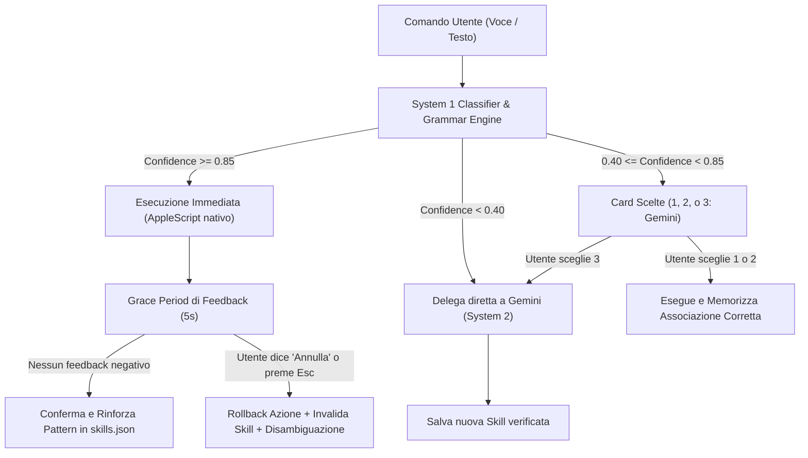

# Piano di Implementazione: System 1 Decision Engine & Continuous Learning

## 1. Visione d'Insieme
Il sistema implementa un'architettura **Dual-System** (ispirata al modello Kahneman):
- **System 1 (Locale, On-Device, reattivo)**: Un motore a bassissima latenza (<50ms) specializzato sui dizionari AppleScript nativi di macOS (Word, Excel, Finder, Finestre, Chrome). Esegue compiti operativi senza chiamare API cloud.
- **System 2 (Cloud, Gemini / Claude, riflessivo)**: Interviene quando la richiesta richiede ragionamento astratto, sintesi o creatività.
- **Disambiguazione Proattiva (Human-in-the-loop)**: Se il System 1 ha un'incertezza (confidenza compresa tra il 40% e l'85%), presenta a schermo tre alternative attivabili a voce (*"uno"*, *"due"*, *"tre"* o *"chiedi a Gemini"*).
- **Apprendimento Continuo con Gestione Falsi Positivi ("Annulla")**: Finestra temporale di feedback (*grace period* di 5 secondi). Se l'utente dice *"annulla"* o preme `Esc`, l'azione viene annullata, la scorciatoia errata rimossa da `skills.json` e viene aperta la card per correggere l'intento.

---

## 2. Diagramma di Flusso Operativo



---

## 3. Struttura dei Moduli nel Progetto

I nuovi componenti vengono inseriti come estensione modulare senza modificare la struttura originale del fork (preservando l'aggiornabilità da `upstream`):

```text
atticus/
├── system_one/                     # Directory dedicata al Decision Model Locale
│   ├── __init__.py
│   ├── apple_catalog.json          # Catalogo delle azioni e template AppleScript
│   ├── engine.py                   # Parser semantico, calcolo confidenza e matching
│   └── apps/                       # Moduli specifici per applicazione
│       ├── word.py                 # Automazioni avanzate per Microsoft Word
│       ├── excel.py                # Automazioni per Microsoft Excel
│       └── window.py               # Controllo avanzato finestre e schermi
├── atticus_feedback.py             # Gestione del Grace Period e rollback su "Annulla"
├── atticus_i18n.py                 # Layer linguistico italiano e alias di sistema
├── atticus_gemini.py               # Integrazione Google Gemini (System 2)
└── Atticus.swift                   # Gestione HUD WebKit, STT it-IT e scorciatoie
```

---

## 4. Specifiche Dettagliate dei Componenti

### 4.1. Catalogo AppleScript (`system_one/apple_catalog.json`)
Contiene le macro sintattiche native per interagire con le applicazioni senza usare il mouse:
- **Microsoft Word**:
  - `new_document`: Crea nuovo documento vuoto.
  - `insert_title`: Inserisce testo con dimensione personalizzata e stile grassetto.
  - `insert_body`: Inserisce paragrafi di testo.
  - `format_selection`: Applica grassetto/corsivo a parole specifiche tramite ricerca interna (`find object`).
  - `save_as`: Salva il documento su percorso specifico in `.docx` o esporta in `.pdf`.
- **Gestione Finestre / Workspace**:
  - `snap_left`, `snap_right`, `maximize`, `center`, `move_to_display`.
- **Finder**:
  - `create_folder`, `move_files`, `reveal_item`.

### 4.2. Motore di Confidenza e Router (`system_one/engine.py`)
- Analizza la richiesta dell'utente tramite analisi grammaticale dei predicati e similarità semantica sui template del catalogo.
- Calcolo dello score:
  - $\text{Score} \ge 0.85$: Esecuzione automatica (zero latenza).
  - $0.40 \le \text{Score} < 0.85$: Trigger della card di disambiguazione.
  - $\text{Score} < 0.40$: Fallback automatico su Gemini.

### 4.3. Modulo di Feedback Loop & Rollback (`atticus_feedback.py`)
- Mantiene uno storico temporaneo in memoria dell'ultima azione:
  - Timestamp di esecuzione.
  - Comando shell/AppleScript eseguito.
  - Contro-comando di rollback (se applicabile, es. chiusura file appena aperto, ripristino posizione finestra).
  - Chiave di skill associata in `~/.config/atticus/skills.json`.
- Ascolto trigger negativi durante il *Grace Period* (5 secondi):
  - Vocali: *"annulla"*, *"no"*, *"sbagliato"*, *"fermati"*, *"non questo"*.
  - Tastiera: tasto `Esc` o clic su *"Annulla"* nell'overlay.
- Azione di rollback:
  - Rimuove o penalizza la skill in `skills.json` per evitare la ripetizione dell'errore.
  - Mostra la notifica *"Azione annullata. Cosa volevi fare?"* con le 3 opzioni.

### 4.4. Disambiguazione Grafica e Vocale
- Sfrutta il componente HUD WebKit già presente in `ui/ui.html`.
- Mostra a schermo una card minimalista con 3 scelte:
  - **[1]** Azione probabile A
  - **[2]** Azione probabile B
  - **[3]** Chiedi a Gemini (analisi avanzata)
- L'utente risponde vocalmente con *"uno"*, *"due"* o *"tre"* (o premendo il relativo tasto numerico).

---

## 5. Fasi di Rilascio

| Fase | Descrizione | Obiettivo / Deliverable |
| :--- | :--- | :--- |
| **Fase 1** | Catalogo AppleScript & Automazioni Word | `system_one/apple_catalog.json` e modulo pilota `word.py` |
| **Fase 2** | Grace Period e Rollback su *"Annulla"* | `atticus_feedback.py` per neutralizzare i falsi positivi |
| **Fase 3** | Router System 1 con calcolo confidenza | `system_one/engine.py` per distinguere comandi certi, dubbi e complessi |
| **Fase 4** | Card interattiva di disambiguazione (1 / 2 / 3) | Trigger visivo e vocale nell'HUD di Atticus |
| **Fase 5** | Test end-to-end e verifica con Gemini | Verifica completa su macOS con Word, Finder e finestre |
